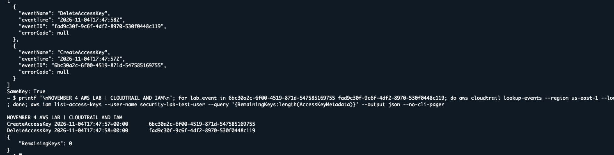

# AWS Detection Reliability Lab

CloudTrail logged my IAM policy attachment, but the alert email never came. The EventBridge rule for that action hadn't been saved. After saving the rule, I repeated the attachment on the test user and matched the CloudTrail event ID to the one in the SNS email. I then removed the policy. [September test notes](evidence/history/test-reports.md)

That experience gave me three things to check separately: whether the pattern matches, whether the rule and its target are set up, and whether an alert actually reaches the inbox.

## How the alert works

```text
IAM action → CloudTrail event → EventBridge rule → SNS topic → email
```

CloudTrail records the API call and the trail stores logs in S3. EventBridge checks the event against the saved rule. SNS delivers the alert when EventBridge invokes the topic. I compared the event ID in CloudTrail with the ID inside the email payload.

## Run the local checks

From the repository folder, run the following with Python 3.10 or newer. The default run uses synthetic events and needs no AWS credentials or packages.

```sh
python3 lab.py
```

The runner compares 16 expected match and nonmatch results and tries five deliberately broken patterns. For example, removing the failed-request filter makes an `AccessDenied` example match. The runner catches that change. It supports the subset of EventBridge pattern syntax used in this lab.

| Check | Result |
| --- | --- |
| Local regression suite | [16/16 synthetic cases passed and 5/5 broken variants caught](reports/november-2-local-baseline.md) |
| Deployed access-key rule | [5/5 read-only configuration checks passed](evidence/2026-11-04/01-test-record.md) |
| Live email delivery | [Two September runs](evidence/history/sns-email-correlation.md) and [one November retest](evidence/2026-11-04/03-fresh-access-key-test.md), covering access-key creation and direct administrator-policy attachment |

To see what the configuration report looks like without an AWS account, run `python3 preflight.py --demo`. This uses fictional AWS responses. The live run in the table was a separate CloudShell check.

## November 4 retest

I created one key for a disposable IAM user and deleted it immediately. The SNS email carried the same creation event ID as CloudTrail. CloudTrail also recorded deletion of that exact key, and an independent IAM check showed zero keys remaining. The recorded mail-server receipt was two seconds after the event in this run. The email arrived before the event appeared in CloudTrail Event History.



[Redacted SNS email](evidence/2026-11-04/05-sns-email-redacted.png) · [Full retest record](evidence/2026-11-04/03-fresh-access-key-test.md)

## Scope

The policy rule checks direct attachment of one specific policy to the lab user. The logging-change rule has local pattern tests, and its email delivery is still unconfirmed. The sample counts describe this lab's tests.

I ran the CloudShell checks and controlled November test. Codex helped scaffold the Python tooling and organize the evidence.
